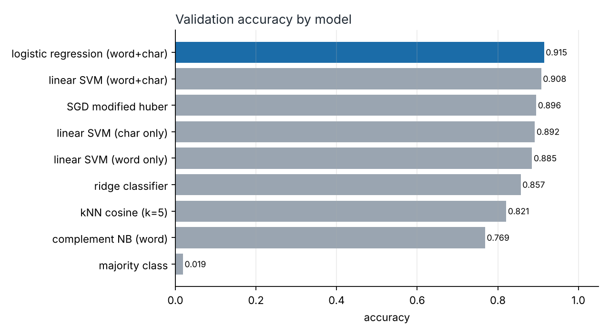
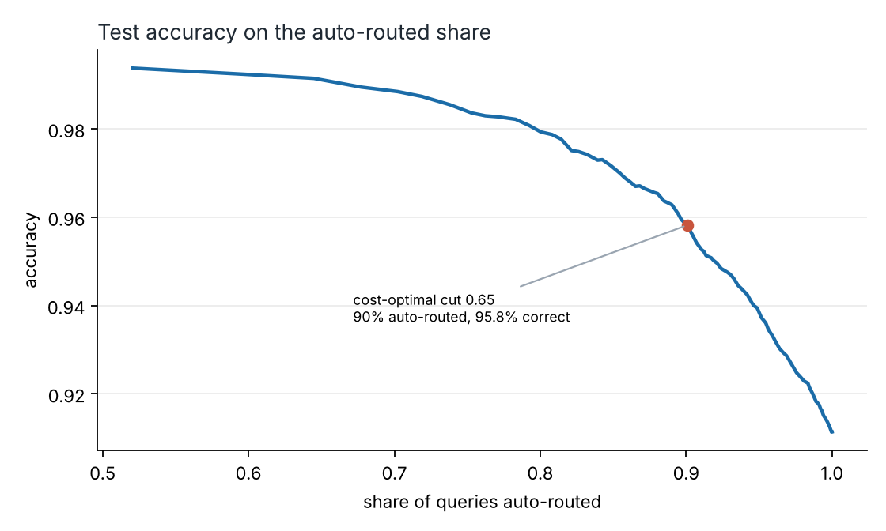
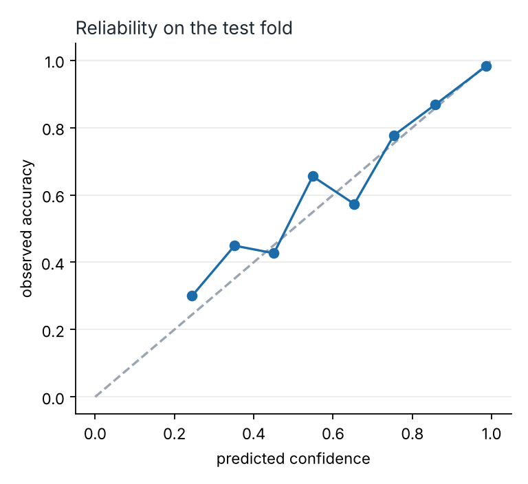
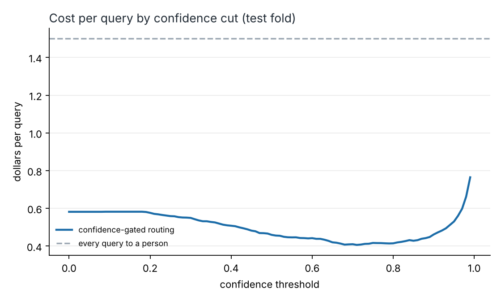
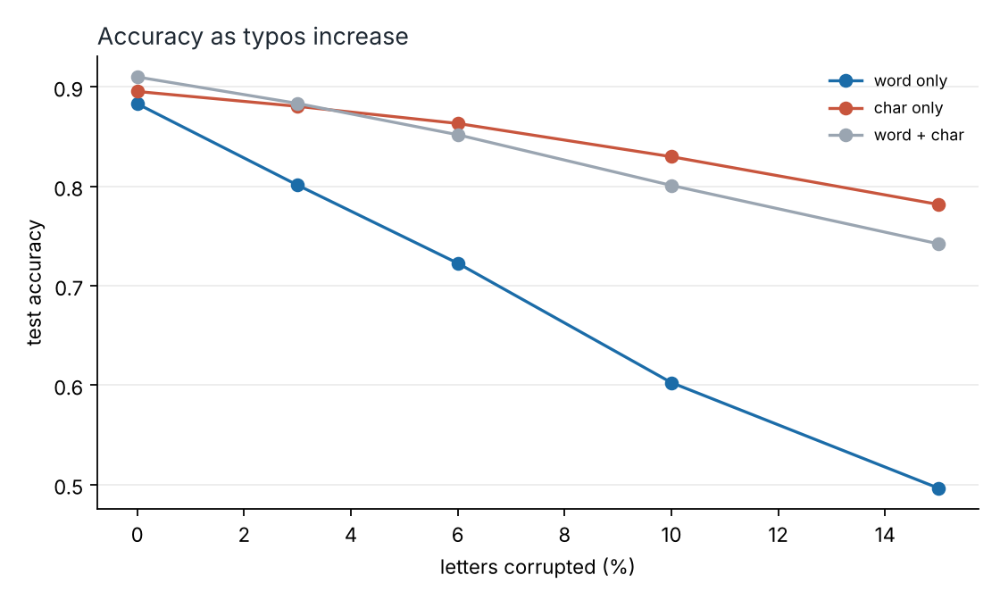
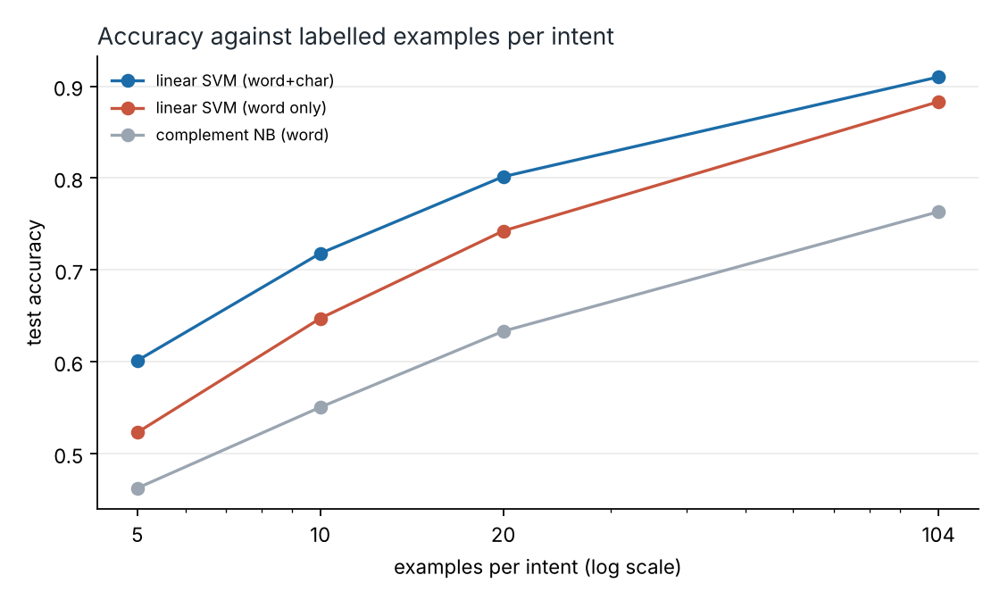

# intentdesk

[](https://github.com/ranjithguggilla/intentdesk/actions/workflows/ci.yml)

A router for banking support messages. It reads a customer query, picks one of 77 intents, and only sends it to a queue automatically when it is confident enough. Everything else goes to a person. I also audit the training labels, because on this dataset a fifth of the remaining mistakes turn out to be the labels' fault rather than the model's.

The whole thing is classical machine learning on purpose: TF-IDF features, a linear model, temperature scaling, and a cost-based confidence cut. It trains in under a minute on a laptop CPU and answers in about 0.09 ms per query.

## Results

Held-out test set: the 3,080 queries from the official BANKING77 test file. I carved a validation fold out of the training file for every choice (model, temperature, threshold), so the test file was read once at the end.

| metric | value |
|---|---|
| test accuracy | 0.9114 (95% bootstrap interval 0.9016 to 0.9211) |
| test macro F1 | 0.9117 |
| top-3 accuracy | 0.9740 |
| expected calibration error, raw softmax | 0.0569 |
| expected calibration error, after temperature scaling | 0.0136 |
| intents classified perfectly | 11 of 77 |

### Model comparison

Every candidate was fitted on the training split and scored on the validation fold. The pick rule is: among models within 0.3 points of the best validation accuracy, take the fastest to fit. Logistic regression was ahead by 0.7 points over the linear SVM, so the rule did not let the SVM through. The SVM is still the better deal if you retrain often: 2.8 seconds against 19.5.

| model | val accuracy | val macro F1 | fit (s) |
|---|---|---|---|
| logistic regression (word+char) | 0.9150 | 0.9153 | 19.5 |
| linear SVM (word+char) | 0.9080 | 0.9062 | 2.8 |
| SGD modified huber | 0.8956 | 0.8944 | 3.0 |
| linear SVM (char only) | 0.8921 | 0.8899 | 2.2 |
| linear SVM (word only) | 0.8851 | 0.8830 | 0.6 |
| ridge classifier | 0.8571 | 0.8524 | 12.5 |
| kNN cosine (k=5) | 0.8211 | 0.8186 | 0.7 |
| complement NB (word) | 0.7686 | 0.7570 | 0.2 |
| majority class | 0.0190 | 0.0005 | 0.1 |



### Routing with a confidence gate

The cost-optimal cut, chosen on the validation fold, is 0.65. On the test fold that auto-routes 90.1% of queries at 95.8% accuracy and holds the other 9.9% for a person. Had the model guessed on that held-back slice it would have been right only 48.7% of the time, so the gate is catching the right messages.




### Cost, with the assumptions stated

These are my assumptions, not measured figures: an auto-routed query costs $0.05, a person triaging one costs $1.20 and is right 95% of the time, and a misrouted query costs $6.00 in bounce-around handling. Volume is set to 1,000,000 queries a year.

| policy | cost per query | per year at 1M queries |
|---|---|---|
| every query to a person | $1.500 | $1,500,000 |
| auto-route everything | $0.582 | $581,818 |
| confidence gate at 0.65 | $0.420 | $420,032 |

The gate saves about $1.08M a year against all-human triage (bootstrap interval over the test sample, threshold held fixed: $1.04M to $1.12M) and about $162k against auto-routing everything. The interval only reflects sampling noise in the test fold. It says nothing about whether my cost figures match your contact centre, so treat the dollar numbers as a template to refill.



### Label audit

BANKING77 is known to contain mislabelled queries. I used confident learning (cleanlab) on 5-fold out-of-fold probabilities over the 10,003 training and validation rows.

| finding | value |
|---|---|
| rows flagged as likely mislabelled | 189 (1.9%) |
| most flagged confusions | pending_top_up vs top_up_failed (13), card_arrival vs card_delivery_estimate (10), top_up_failed vs top_up_reverted (9) |
| validation accuracy, original vs flagged rows dropped from training | 0.9150 vs 0.9115 |
| test accuracy, original vs flagged rows dropped from training | 0.9114 vs 0.9088 |
| test rows flagged | 52 of 3,080, all among the model's 273 test errors |
| test accuracy with those 52 rows set aside | 0.9270 |

Two things I take from this. Dropping flagged rows from training did not help; it cost a quarter of a point, probably because some flagged rows are only ambiguous, not wrong, and removing them throws away real signal. And roughly 19% of the test errors sit on rows the audit considers suspect, so the headline 91% understates the model a little and the remaining ceiling is lower than it looks. The first 200 flagged rows are in `artifacts/suspected_label_errors.csv` for someone to review by hand.

### Typos

I corrupt a fraction of letters in the test queries (neighbouring-key swaps, drops, doubled and transposed letters) and retrain nothing.

| letters corrupted | word only | char only | word + char |
|---|---|---|---|
| 0% | 0.883 | 0.895 | 0.910 |
| 3% | 0.801 | 0.881 | 0.883 |
| 6% | 0.723 | 0.863 | 0.852 |
| 10% | 0.603 | 0.830 | 0.801 |
| 15% | 0.496 | 0.782 | 0.742 |

Character n-grams are what keep the model usable on messy mobile text. The combined model wins on clean text, but past about 5% corruption the char-only model is ahead, which I did not expect. If your traffic is mostly typed on phones, char-only is the safer choice.



### Few labels

Accuracy of three models trained on a random handful of examples per intent (three draws averaged, last point uses the full training split of about 104 per intent). All three are linear SVM or naive Bayes, so this is word and character features doing the work, no pretrained embeddings.

| examples per intent | SVM word+char | SVM word | complement NB |
|---|---|---|---|
| 5 | 0.601 | 0.523 | 0.462 |
| 10 | 0.718 | 0.647 | 0.550 |
| 20 | 0.802 | 0.742 | 0.633 |
| 104 | 0.910 | 0.883 | 0.763 |



## Architecture

```
 customer message
        |
        v
 +------------------+     +----------------------+
 | TF-IDF features  | --> | logistic regression  |
 | word 1-2 grams   |     | 77 intents           |
 | char 2-5 grams   |     +----------+-----------+
 +------------------+                |  raw scores
                                     v
                          +----------------------+
                          | temperature scaling  |  fitted on validation fold
                          +----------+-----------+
                                     |  calibrated probabilities
                                     v
                          +----------------------+
                          | confidence >= 0.65 ? |  cut chosen by expected cost
                          +-----+----------+-----+
                            yes |          | no
                                v          v
                        auto-route     human queue
                        + top terms    + top-3 intents
                          as reason      as a hint
```

## Installation

```bash
git clone https://github.com/ranjithguggilla/intentdesk.git
cd intentdesk
python -m venv .venv && source .venv/bin/activate
pip install -r requirements.txt
pip install -e .
```

Python 3.10 or newer. The dataset is vendored in `data/`, so there is nothing to download.

## Usage

1. Train and evaluate everything. This writes the metrics, charts and the model file. It takes around four minutes, most of it the five-fold label audit.

   ```bash
   python -m intentdesk.pipeline
   ```

   Use `--quick` for a faster smoke run with a smaller audit and learning curve.

2. Route one message from the shell.

   ```bash
   python -m intentdesk.cli "My card still has not arrived after two weeks"
   ```

   which prints, for the model in this repo:

   ```
   card_arrival  (99%)  auto-route
   the wording ("card", "weeks", "card still", "my card") points to card arrival; confidence 99%, sent straight to the queue.
   ```

3. Route a CSV that has a `text` column.

   ```bash
   python -m intentdesk.cli --csv incoming.csv > routed.csv
   ```

4. Start the web demo.

   ```bash
   python -m intentdesk.app
   ```

   Then open http://127.0.0.1:7860.

## Configuration

Seeds, the validation fraction and the cost assumptions live in `src/intentdesk/config.py`. To rerun the business numbers with your own figures, edit the `CostModel` defaults (auto-route cost, human triage cost, misroute cost, human accuracy, yearly volume) and rerun the pipeline; the threshold is re-optimised on the validation fold each time. The model-selection tolerance (`TOLERANCE`) is at the top of `pipeline.py`.

## Output structure

```
artifacts/
  metrics.json                  every number quoted above
  model_comparison.csv          validation scores and timings per model
  suspected_label_errors.csv    first 200 rows the audit flags
  intent_router.skops           trained router (not committed, about 50 MB)
assets/                         charts used in this README
```

## Project structure

```
src/intentdesk/
  config.py       paths, seeds, cost assumptions
  data.py         loading, validation, stratified split, overlap check
  features.py     word and character TF-IDF
  models.py       candidate models and comparison harness
  calibration.py  temperature scaling, ECE, coverage curve, cost policy
  audit.py        out-of-fold probabilities, cleanlab flags, confusion pairs
  robustness.py   keyboard-style typo generator
  explain.py      plain-language reasons from linear weights
  router.py       the scoring function used by the app, CLI and tests
  persist.py      skops save and load
  pipeline.py     the end-to-end run
  app.py, cli.py  Gradio demo and command line
tests/            pytest suite
data/             BANKING77 train, test and intent list
```

## Technical details

- Features are fitted inside the scikit-learn pipeline, so vectorizer vocabulary and IDF weights never see validation or test text.
- Logistic regression is multinomial with C=30 on 37,726 features. The raw model is a little under-confident, so a single temperature of 0.76 (below 1 sharpens), fitted by minimising validation log loss, brings expected calibration error from 0.057 to 0.014.
- The reasons shown to agents come from the word-level coefficients of the predicted class multiplied by the query's TF-IDF values, so they are exact for this model and cost nothing extra.
- The model is stored with skops rather than pickle. Loading checks that every type in the file comes from numpy, scipy, scikit-learn or this package before trusting it.
- 25 of the 3,080 test queries also appear (ignoring case and punctuation) in the training and validation data. That is under 1% and I left them in so the numbers match what other people report on the same split.
- I tried a nearest-centroid classifier too, but scikit-learn's version ran out of memory on sparse input here, so it is not in the table.
- No pretrained language model is used. That keeps the project reproducible offline and cheap to serve, but a fine-tuned encoder would probably beat 91% on this dataset, and comparing against one is the obvious next step.

## Testing

```bash
pip install pytest pytest-cov ruff
ruff check .
pytest -q --cov=intentdesk
```

35 tests, 96% line coverage. They cover the split and its determinism, schema errors, temperature scaling on synthetic overconfident scores, the cost policy at both extremes, the typo generator, label-issue detection on a planted flip, the routing function and its reasons, the Gradio app construction, model save and load, and a quick end-to-end pipeline run on a tiny synthetic dataset. CI runs lint and the tests on every push, and on main it also trains the model and uploads it as a build artifact.

## Dataset

BANKING77 by Inigo Casanueva, Tadas Temcinas, Daniela Gerz, Matthew Henderson and Ivan Vulic, released by PolyAI under CC BY 4.0: https://github.com/PolyAI-LDN/task-specific-datasets. Paper: "Efficient Intent Detection with Dual Sentence Encoders", 2020. The licence text is in `data/DATASET_LICENSE`.

## License

MIT, see `LICENSE`. The dataset keeps its own CC BY 4.0 licence.
